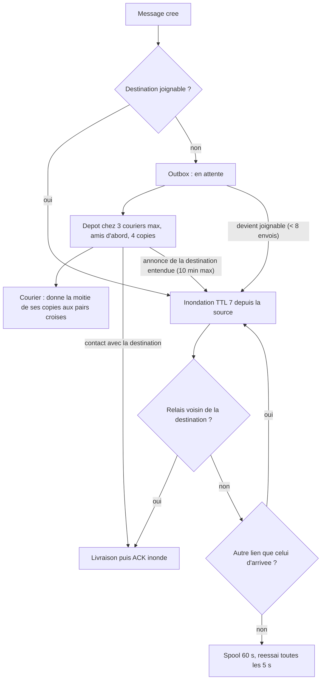

# `bitchat` — messages prives de bitchat

Fichier : `src/festival_ble_sim/routing/bitchat.py`
Spec : `docs/algorithmes/specs/BITCHAT.md`

## Principe

Reduction au niveau reseau du chemin des messages prives de bitchat
(application iOS `permissionlesstech/bitchat`, commit `5e9287f`), avec ses
constantes par defaut. Sous-classe de `managed_flood` (cache, ACK inondes).
Trois couches :
- **maillage** : inondation dirigee, TTL 7, relais systematique (pas de
  plafond selon le degre pour les messages prives), dedup 1000 ids / 300 s ;
  un noeud voisin direct de la destination n'envoie qu'a elle ; un relais
  sans autre lien que celui d'arrivee met le paquet en spool 60 s et
  reessaie toutes les 5 s ;
- **outbox de la source** : elle n'inonde que si la destination est
  joignable (son annonce, 7 sauts ramenes a 5 apres un noeud de 6 voisins
  ou plus, entendue il y a moins de 60 s, verifiee toutes les 4 s),
  reemet a chaque passage injoignable -> joignable, 8 envois au plus, et
  garde le message jusqu'a l'ACK ;
- **couriers** : la source confie une copie scellee a 3 pairs connectes
  au plus, amis d'abord, avec un budget spray-and-wait de 4 copies
  divise par deux a chaque pair rencontre ; un courier livre au contact de
  la destination, ou relance une inondation quand l'annonce de la
  destination l'atteint (au plus toutes les 10 min). Quotas par courier :
  40 enveloppes (20 de non-amis), 5 par ami deposant, 2 par non-ami.

Non modelise : jitter de relais (sous le tick), chiffrement Noise et
poignees de main, fragmentation, routage par source, passerelles Nostr,
eviction dans le stock d'un courier plein (refus a la place). Les ACK sont
ceux de `managed_flood` (inondes, ils purgent aussi les copies).

## Diagramme

## Forces

- Fidele au code de l'application reelle : memes constantes.
- Livraison elevee en festival clairseme grace a l'outbox et aux couriers,
  avec bien moins de transmissions qu'`epidemic`.
- N'inonde que quand la destination est joignable : pas de tempete pour
  un destinataire absent.

## Faiblesses

- Latence elevee quand la destination n'est pas joignable : il faut
  qu'un courier la croise ou l'entende.
- Le moteur compte les sauts de bout en bout : son TTL (`message_ttl_hops`,
  8) borne aussi les copies de couriers, que bitchat relance a TTL plein.
- Joignabilite calculee sur le graphe des voisins du tick (annonce
  instantanee), sans pertes.
- Les bornes ne servent que de relais, jamais de couriers.

## References

Origine : Reduction au niveau reseau du code de bitchat (ecarts dans la spec).

- bitchat, application iOS, depot `github.com/permissionlesstech/bitchat`, commit `5e9287f`. — source des constantes et du comportement (`RelayController`, `BLEService`, `MessageRouter`, `CourierStore`).
- Bluetooth SIG, *Mesh Profile Specification* 1.0, 2017 (remplacee par *Mesh Protocol Specification* 1.1, 2023). — inondation geree heritee de `managed_flood`.
- T. Spyropoulos, K. Psounis, C. S. Raghavendra, *Spray and Wait: An Efficient Routing Scheme for Intermittently Connected Mobile Networks*, ACM SIGCOMM WDTN, p. 252-259, 2005. — budget des couriers (division binaire des copies).
