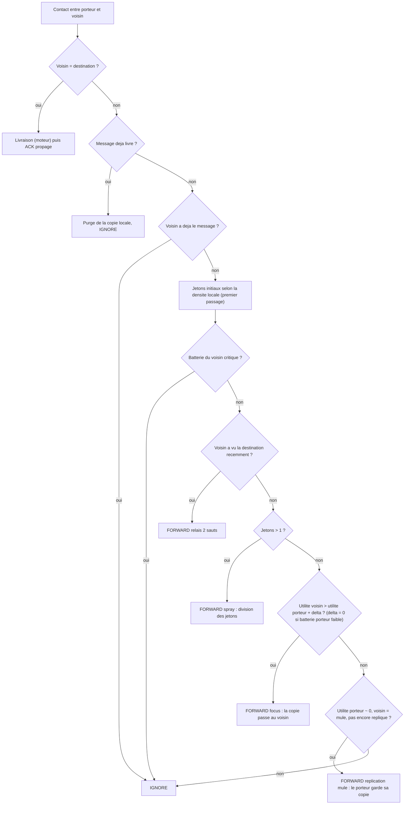

# `dasfv` — DASF-V (Density-Aware Spray-and-Focus + purge)

Fichier : `src/festival_ble_sim/routing/dasfv.py`
Spec : `docs/algorithmes/specs/DASF-V.md`

## Principe

Version reduite au niveau reseau (pas de crypto, GATT, SOS ni epoques ;
voir l'en-tete du fichier) :
- budget de copies initial adapte a la densite locale (entre `k_min` et
  `l_max`, reference `l_base`) ;
- phase *spray* (division des jetons) puis phase *focus* par gradient
  d'utilite PRoPHET ;
- relais a 2 sauts (voisin qui a vu la destination recemment) et
  heuristique de *mule* (noeud mobile a fort renouvellement de contacts) ;
- politique batterie : refus des pairs en batterie critique, evacuation
  acceleree depuis un porteur en batterie faible ;
- purge des copies par l'ACK du destinataire, propage par le moteur sur les connexions.

## Diagramme

Observation a chaque tick (`on_tick`), pour toutes les paires a portee,
qu'elles aient ou non quelque chose a s'envoyer : densite, vue a 2 sauts,
rotation des fenetres de contacts (mule) et vitesse. Une rencontre PRoPHET
compte une fois par contact, pas a chaque tick ou il dure.

Decision prise pour chaque message du porteur a chaque contact :

## Forces

- Combine le budget borne de Spray and Wait et l'orientation de PRoPHET.
- S'adapte a la densite au lieu d'un `L` fixe.
- Le mode focus evite la longue phase wait aveugle de Spray and Wait.
- La purge libere buffers et energie apres livraison.
- Protege les telephones en fin de batterie.

## Faiblesses

- Beaucoup de parametres (une vingtaine) : calibration delicate, risque de
  sur-ajustement a un scenario.
- Les vues exactes de l'instance partagee (densite, 2 sauts ; leur echange
  est facture une fois par connexion) sont optimistes par rapport a un vrai deploiement ou ces
  informations transitent par des balises ou des filtres de Bloom.
- Latence plus elevee que les approches par inondation.
- L'economie porte surtout sur l'overhead, moins sur la consommation radio
  de fond.

## References

Origine : Spec NICE `docs/algorithmes/specs/DASF-V.md`, conception propre au projet. Briques reprises :

- T. Spyropoulos, K. Psounis, C. S. Raghavendra, *Spray and Focus: Efficient Mobility-Assisted Routing for Heterogeneous and Correlated Mobility*, IEEE PerCom Workshops, 2007. — spray puis focus par gradient d'utilite.
- T. Spyropoulos, K. Psounis, C. S. Raghavendra, *Efficient Routing in Intermittently Connected Mobile Networks: The Multiple-Copy Case*, IEEE/ACM Transactions on Networking 16(1), 2008. — budget de copies dimensionne sur le reseau (ici sur la densite locale).
- A. Lindgren, A. Doria, O. Schelen, *Probabilistic Routing in Intermittently Connected Networks*, ACM SIGMOBILE Mobile Computing and Communications Review 7(3), p. 19-20, 2003 (poster MobiHoc 2003 ; version longue : SAPIR 2004, LNCS 3126, p. 239-254). — utilite du focus.
- M. Grossglauser, D. Tse, *Mobility Increases the Capacity of Ad Hoc Wireless Networks*, IEEE INFOCOM, 2001. — relais a 2 sauts.
- R. C. Shah, S. Roy, S. Jain, W. Brunette, *Data MULEs: Modeling and Analysis of a Three-tier Architecture for Sparse Sensor Networks*, Ad Hoc Networks 1, p. 215-233, 2003. — heuristique de mule (noeud mobile qui transporte pour les autres).
- X. Zhang, G. Neglia, J. Kurose, D. Towsley, *Performance Modeling of Epidemic Routing*, Computer Networks 51(10), 2007. — purge des copies apres livraison : schemas de recuperation (IMMUNE, VACCINE) du routage epidemique.
