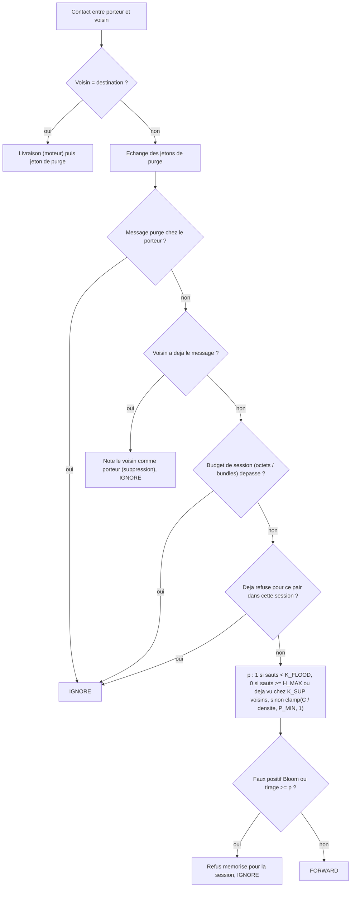

# `gossip_a` — GOSSIP-A (gossip probabiliste adaptatif)

Fichier : `src/festival_ble_sim/routing/gossip_a.py`
Spec : `docs/algorithmes/specs/GOSSIP-A.md`

## Principe

Version reduite au niveau reseau (pas de crypto, etiquettes, PoW ni SOS) :
- probabilite de retransmission `p = clamp(C / densite, P_MIN, 1)`, tiree
  une fois par (message, pair) et par session ;
- inondation totale des `K_FLOOD` premiers sauts, borne `H_MAX` ;
- anti-entropie par resume Bloom (faux positifs simules) ;
- suppression par compteur (message deja vu chez `K_SUP` voisins) ;
- jetons de purge propages de proche en proche apres livraison ;
- budgets par session (octets, bundles) et eviction « plus repliques
  d'abord » (`choose_eviction`). Le budget en octets (`session_budget_bytes`)
  vaut 256 Ko et non les 32 Ko de la spec : un message de l'app pese
  ~2 400 o sur le fil (`docs/radio/mesures.md`), 32 Ko n'en laisseraient
  passer que ~13 par minute vers un meme voisin ; avec 256 Ko, c'est la
  limite de 50 messages par minute qui joue, comme avant le recalage.
  Le PURGE_SYNC (Bloom de 128 o par connexion) est facture 2 000 o, sa
  taille estimee au format de l'app (`purge_sync_bytes`).

Les interrupteurs `adaptive`, `suppression` et
`replicated_first_eviction` permettent des ablations.

## Diagramme

La densite est mesuree a chaque tick (`on_tick`) sur tous les voisins a
portee, pas seulement ceux a qui le porteur a quelque chose a offrir.

Decision prise pour chaque message du porteur a chaque contact :

## Forces

- Livraison elevee et latence basse : se rapproche de l'inondation sans en
  avoir tout le cout.
- Tire bien parti des bornes.
- Adaptatif a la densite : inonde en zone clairsemee, se retient en foule.
- L'eviction « plus repliques d'abord » protege les messages rares quand
  les buffers saturent.
- Modelise des imperfections realistes (faux positifs Bloom, budgets de
  session).

## Faiblesses

- Overhead nettement plus eleve que les approches a budget de copies
  (`spray_wait`, `dasfv`, `bubble_f`).
- Consommation d'energie proche de l'inondation.
- Aleatoire (RNG propre, `seed`) : resultats plus variables d'un seed a
  l'autre.
- Nombreux parametres (`C`, `P_MIN`, `K_FLOOD`, `H_MAX`, `K_SUP`,
  fenetres, budgets).

## References

Origine : Spec NICE `docs/algorithmes/specs/GOSSIP-A.md`, conception propre au projet. Briques reprises :

- Z. J. Haas, J. Y. Halpern, L. Li, *Gossip-Based Ad Hoc Routing*, IEEE INFOCOM, 2002 (arXiv cs/0209011). — retransmission avec probabilite `p` apres inondation des `k` premiers sauts (GOSSIP1(p,k)), d'ou `K_FLOOD`.
- S.-Y. Ni, Y.-C. Tseng, Y.-S. Chen, J.-P. Sheu, *The Broadcast Storm Problem in a Mobile Ad Hoc Network*, ACM MobiCom, p. 151-162, 1999. — suppression par compteur (*counter-based scheme*), d'ou `K_SUP`.
- A. Demers et al., *Epidemic Algorithms for Replicated Database Maintenance*, ACM PODC, p. 1-12, 1987. — anti-entropie entre pairs.
- B. H. Bloom, *Space/Time Trade-offs in Hash Coding with Allowable Errors*, Communications of the ACM 13(7), 1970. — resume Bloom et ses faux positifs.
- X. Zhang, G. Neglia, J. Kurose, D. Towsley, *Performance Modeling of Epidemic Routing*, Computer Networks 51(10), 2007. — purge des copies apres livraison : schemas de recuperation (IMMUNE, VACCINE) du routage epidemique.
