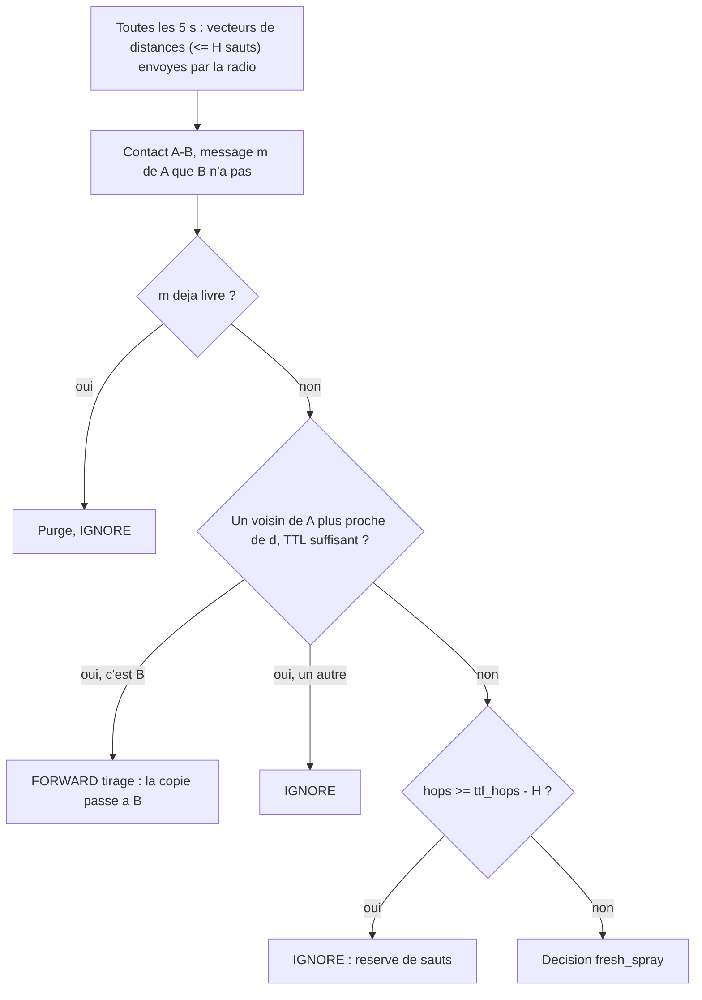

# `horizon` — fresh_spray + tirage le long d'un champ de distances

Fichier : `src/festival_ble_sim/routing/horizon.py`
Spec : `docs/algorithmes/specs/HORIZON.md`

## Principe

Sous-classe de `fresh_spray` : hors de l'horizon du destinataire, tout est
identique (spray, replique « a vu la destination », focus FRESH, bornes,
purge). S'y ajoutent :

1. **Champ de distances** : toutes les `announce_period_s` (5 s), a sa
   propre phase, chaque noeud diffuse son vecteur de distances
   (destinations a `horizon_hops` sauts ou moins, 9 octets par entree :
   id, distance, prochain saut), reconstruit juste avant a partir du
   dernier vecteur entendu de chaque voisin depuis moins de `entry_ttl_s`
   (15 s). Une annonce perdue n'efface donc pas la route ; un voisin muet
   disparait apres 15 s. Split horizon : un noeud ignore les routes dont
   le prochain saut est lui-meme (pas de route fantome qui s'allonge entre
   deux voisins quand la destination part). Une annonce est plafonnee a
   `max_announce_bytes` (1650 o, advertising etendu BLE 5), destinations
   les plus proches d'abord. Les vecteurs passent par la radio du moteur
   (`control_broadcasts`) avec les memes regles qu'un message : backoff
   (un seul tirage par tick pour l'annonce et les donnees), budget
   d'antenne, congestion, pertes, energie tx/rx ; seuls ceux recus sont
   fusionnes, et pas ceux d'un emetteur hors de portee du recepteur (borne
   entendue mais injoignable). Le tirage lit ces vecteurs recus, jamais la
   table courante du voisin.
2. **Tirage** : si un voisin est plus proche du destinataire que le
   porteur (selon le champ), la copie lui passe (le porteur la supprime,
   les jetons suivent ; une borne garde la sienne et ne donne qu'un
   jeton), un saut par tick. Seul le meilleur voisin (plus
   petite distance, puis le plus proche physiquement) est vise ; les autres
   contacts sont ignores pour ce message. Le tirage n'a lieu que si le TTL
   de sauts restant permet d'arriver (`hops + h <= ttl_hops`).
3. **Reserve de sauts** : hors tirage, une copie a `hops >= ttl_hops -
   horizon_hops` ne se replique plus ; ces sauts restent pour un tirage.
4. **Liaisons** : `select_links` place les prochains sauts de tirage avant
   les voisins les plus proches (un plus court chemin prefere les longs
   bonds, que le plafond `max_concurrent_links` couperait).

`stats` compte `pull` (tirages reussis), `announces_sent`,
`announces_received`, `announce_bytes` et `announce_rx_bytes` (part
d'antenne des annonces) ; `announces_sent` et `announce_bytes` ne
comptent que les annonces reellement emises.

## Diagramme

## Forces

- Exploite la topologie multi-saut instantanee, qu'aucun autre algorithme
  n'utilise comme gradient : en foule dense (`poi`, 500 personnes), 60 %
  des messages ont leur destinataire dans la meme composante connexe a la
  creation, 31 % a 8 sauts ou moins.
- Contre `fresh_spray` (300 personnes, `poi`, 30 min, 2 seeds) : overhead
  -30 %, latence -4 % avec 6 bornes (263 s contre 273 s) et -6 % sans
  (411 s contre 438 s), energie mesh +0,6 %, livraison -1,0 pt avec bornes
  et +0,3 pt sans. Detail dans la spec, section 8.
- Une seule copie suit le gradient : pas d'inondation, contrairement a
  `bitchat` quand la destination est joignable.
- Sans GPS ni historique de rencontres.

## Faiblesses

- Cout des annonces : une emission par noeud et par tour, plus une
  reception par voisin, croissant avec la taille de la boule a H sauts ;
  elles prennent du temps d'antenne aux messages et se perdent comme eux.
- La reserve de sauts bride le spray de `fresh_spray` (3 sauts DTN avec
  H = 5 et TTL 8) : en zone clairsemee, des copies qui auraient pu se
  rapprocher par relais restent sur place.
- Sans numeros de sequence, une boucle d'au moins trois noeuds peut
  encore faire grandir une route fantome, jusqu'a `horizon_hops`.
- Champ en retard de jusqu'a H x 5 s : un chemin tire peut casser en route
  (la copie reste alors chez le dernier porteur, qui redevient DTN).
- Le prochain saut est souvent en bord de portee, ou la perte de paquet
  est plus forte : un echec est retente au tick suivant.
