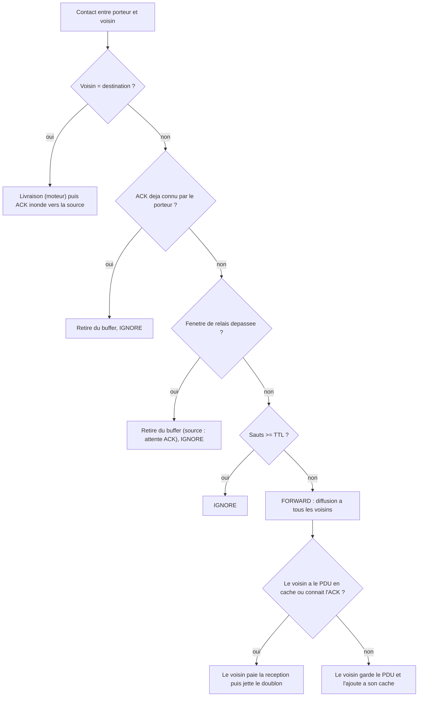

# `managed_flood` — inondation geree (Bluetooth Mesh)

Fichier : `src/festival_ble_sim/routing/managed_flood.py`
Spec : `docs/algorithmes/specs/MANAGED-FLOOD.md`

## Principe

Reduction au niveau reseau de l'inondation geree du Bluetooth Mesh, sans
stockage-transport :
- un noeud ne relaie un PDU que pendant `relay_window_s` apres l'avoir
  recu, puis l'oublie (la source aussi) ;
- TTL en sauts (`ttl`) : au-dela, plus de relais ;
- cache de messages par noeud, taille fixe (`cache_size`, FIFO, cle
  `(msg_id, SEQ)`) : tout PDU deja vu est rejete, meme apres oubli du
  contenu ;
- mode acquitte (`acknowledged=True`, defaut) : la destination emet un ACK
  propage par inondation geree (memes regles TTL/fenetre, en diffusions radio qui peuvent se perdre) qui purge les
  copies ; sans ACK apres `ack_timeout_s`, la source reemet avec un
  nouveau SEQ (nouveau PDU pour les caches), au plus
  `max_source_retransmissions` fois.

Chaque saut d'ACK coute l'energie tx/rx de `ack_size_bytes` (defaut 16 o : les ACK inondes
partent en diffusion, en paquets binaires, et non au format JSON de l'app,
voir `docs/radio/mesures.md` ;
cout calcule avec `EnergyConfig` par defaut ou celui passe en `energy`).

Non modelise : chiffrement, IV index, relais friend/low-power, temps
d'antenne des ACK (le budget de lien du moteur ne les voit pas).

## Diagramme

Decision prise pour chaque message du porteur a chaque contact :

Le porteur ne sait pas ce que ses voisins ont deja : il diffuse a chaque
tick de sa fenetre de relais, tous les voisins recoivent (temps d'antenne
et energie de reception) et c'est le cache du recepteur qui ecarte les
doublons, comme dans le Bluetooth Mesh.

A chaque tick, hors contact : les PDU hors fenetre sont retires des
buffers, les ACK se propagent d'un saut, et une source sans ACK apres
`ack_timeout_s` reemet avec un nouveau SEQ (ou abandonne apres
`max_source_retransmissions`).

## Forces

- Sans tempete : chaque noeud ne garde un PDU qu'une fois (cache) et ne
  le diffuse que pendant sa fenetre de relais.
- Buffers quasi vides : un PDU ne vit que quelques secondes par noeud.
- Latence minimale quand un chemin existe : un saut par tick.
- Deterministe, aucune connaissance globale requise pour decider.
- Fidele a un protocole reel (Bluetooth Mesh), reference utile face aux
  algos DTN.

## Faiblesses

- Pas de stockage-transport : si la destination n'est pas joignable
  pendant la fenetre, le message est perdu (hors reemissions). En festival
  clairseme, la livraison chute nettement face aux algos DTN.
- Les reemissions de la source ne rattrapent que des coupures courtes
  (`ack_timeout_s` x `max_source_retransmissions`).
- Le TTL ne borne que le relais : le moteur livre encore a la destination
  un PDU dont les sauts ont atteint le TTL (regle commune a tous les
  algos, plus permissive que le Bluetooth Mesh).
- Le cache de taille fixe peut oublier un PDU sous forte charge et le
  laisser repasser.
- Les ACK ne consomment pas de bande passante dans le modele.
- Couteux en octets : chaque relais diffuse a chaque tick de sa fenetre,
  meme quand tous ses voisins ont deja le PDU (mesure oct. 2026, 300
  personnes : x4,3 octets par message livre en zone clairsemee, x1,9 en
  zone dense, par rapport a l'ancienne version qui ne diffusait qu'aux
  voisins sans le PDU ; livraison inchangee).

## References

Origine : Reduction au niveau reseau d'un protocole standardise (ecarts dans la spec).

- Bluetooth SIG, *Mesh Profile Specification* 1.0, 2017 (remplacee par *Mesh Protocol Specification* 1.1, 2023). — couche reseau : relais (*Relay feature*), TTL, cache de messages reseau ; messages acquittes de la couche transport.
