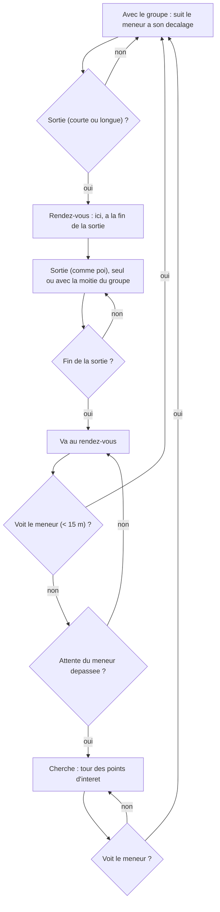

# `group` — groupes d'amis qui se deplacent ensemble

Fichier : `src/festival_ble_sim/mobility/group.py` (`GroupMobility`)
Reglages : `GroupConfig` (`MobilityConfig.group`, `src/festival_ble_sim/config.py`)
Tests : `tests/test_mobility_group.py`
CLI : `--mobility group` (active d'office par `--size`)

## Principe

En festival on se deplace en groupe, et on ecrit surtout a l'ami dont on
vient d'etre separe. Avec `poi`, les groupes d'amis (`SocialConfig`, qui
choisissent aussi les destinataires des messages) etaient tires sans lien
avec les positions : un destinataire etait n'importe ou sur le site.

Modele de groupe a point de reference (RPGM) : chaque groupe d'amis a un
meneur, le premier membre (par identifiant) present sur le site et avec le
groupe. Il le reste jusqu'a ce qu'il quitte le festival (`on_site`, churn) ;
un telephone mort ne change rien, la personne continue de marcher. Un ami
arrive apres lui ne prend pas sa place.

1. **Meneur** : se deplace comme `poi` (memes points d'interet, memes
   pauses, meme programme avec `--schedule`) ; le groupe suit.
2. **Membre** : garde un decalage fixe tire dans un disque de
   `radius_m` (5 m) autour du meneur, et le suit a `speed_max_mps`.
3. **Sorties** : un membre avec le groupe part avec un taux de
   `short_trips_per_hour` (0,5/h, 5 a 30 min : bar, toilettes) ou
   `long_trips_per_hour` (0,2/h, 30 min a 2 h : une autre scene). Pendant
   la sortie, il se deplace comme `poi`. Avec la probabilite
   `split_probability` (0,3, estimee) **le groupe se scinde en deux** : il
   emmene environ la moitie des autres membres (`(taille - 1) // 2`, jamais
   le meneur), qui le suivent a leur decalage puis reviennent avec lui ;
   sinon il part seul. Si celui qui mene la sortie quitte le festival, ceux
   qui le suivaient vont seuls au rendez-vous.
4. **Rendez-vous** : personne ne peut appeler ni ecrire (le reseau
   cellulaire est sature, et la mobilite ne doit pas dependre du reseau
   simule, sinon chaque algorithme aurait ses propres trajectoires et la
   comparaison a graine egale ne tiendrait plus). Avant de partir, le
   membre et le groupe conviennent donc de se retrouver **ici, a la fin de
   la sortie**. A l'heure dite, le meneur (et tout le groupe avec lui)
   retourne au point de rendez-vous et y attend au plus
   `rendezvous_max_wait_s` (15 min) ; le membre y va aussi.
5. **Recherche** : un membre qui arrive apres la fin de l'attente fait le
   tour des points d'interet (sans pause) jusqu'a voir son groupe, c'est-a-
   dire passer a moins de `visual_range_m` (15 m) du meneur. En revenant
   ou en cherchant, il rejoint le groupe des qu'il le voit. Un membre qui
   arrive sur le site apres son groupe (churn) ne sait pas ou il est : il
   commence en recherche. S'il ne reste plus personne avec le groupe (tous
   partis ou en sortie), celui qui revient devient le groupe.
6. **Departs** : un membre qui quitte le festival n'est plus attendu aux
   rendez-vous.

Les personnes sans amis (`no_friend_fraction`, 20 %) se deplacent comme
`poi`. Les membres demarrent autour de leur meneur
(`simulation.run_simulation` appelle `MobilityModel.join_group` une fois
les groupes tires).

## Effet sur le trafic

On n'ecrit pas a un ami qu'on voit : au moment d'un envoi, les amis a
moins de `TrafficConfig.skip_friends_within_m` (15 m, position reelle)
sont ecartes, le destinataire est tire parmi les autres, et s'il n'en
reste aucun l'envoi est **annule** (pas reporte). Les amis sont le groupe
(`social.assign_friend_groups`, groupes disjoints, ceux qui se deplacent
ensemble) plus 0 a 2 **amis venus a part** tires dans d'autres groupes
(`SocialConfig.outside_friends_range`, `social.add_outside_friends` ;
`--no-outside-friends` les retire) :

- tant que tout le groupe est reuni, on n'ecrit qu'a ses amis venus a
  part, ailleurs sur le site, qu'on n'a parfois pas vus de la journee ;
- les autres messages naissent d'une **separation** : le membre parti
  ecrit au groupe, ou le groupe ecrit au membre parti (sortie, retour au
  rendez-vous, recherche) ;
- a taux personnel egal (`messages_per_hour_range`), moins de messages
  sont crees qu'avec `poi`, ou les amis sont disperses et le filtre
  n'ecarte presque personne. Le taux reel depend donc de `GroupConfig`
  (frequence et duree des sorties) et du nombre d'amis venus a part.

En plus de ce rythme fixe, un rendez-vous rate fait ecrire : de l'heure
prevue jusqu'au retour dans le groupe (et pour un ami arrive apres son
groupe), le perdu ecrit a un membre du groupe et le meneur ecrit au perdu,
chacun a `TrafficConfig.lost_messages_per_hour` (6/h, estime ;
`--no-lost-messages` = 0). Le trafic suit la mobilite, jamais l'inverse :
les trajectoires restent les memes pour tous les algorithmes.
`GroupMobility.lost_peers()` dit a qui ecrire, `traffic.lost_process`
envoie.

Les reponses (`--reply-probability`) et relances (`--followup-probability`)
ne repassent pas par ce filtre : elles partent meme si le destinataire est
revenu a moins de 15 m entre-temps (20 a 180 s plus tard, c'est rare).

## Diagramme

## Forces

- Les distances source-destination ressemblent a un festival : la plupart
  des amis sont a cote, ceux qui sont separes sont a une autre scene ou au
  bar, ce que la messagerie doit justement couvrir.
- Independant du reseau simule : memes trajectoires pour tous les
  algorithmes a une graine donnee.

## Faiblesses

- Toutes les valeurs de `GroupConfig` sont estimees, pas mesurees ; comme
  elles fixent le nombre de separations, elles fixent aussi la charge du
  reseau (voir "Effet sur le trafic").
- Une scission se fait toujours en deux, autour d'une sortie qui finit
  par un rendez-vous ; le groupe restant suit toujours le meneur au
  rendez-vous, et deux sous-groupes ne se separent pas a nouveau.
- Le nombre d'amis venus a part (0 a 2) est estime, et ils sont tires au
  hasard sur tout le site : rien ne rapproche deux groupes qui se
  connaissent.

## References

- X. Hong, M. Gerla, G. Pei, C.-C. Chiang, *A Group Mobility Model for Ad
  Hoc Wireless Networks*, ACM MSWiM, 1999. — modele de groupe a point de
  reference (RPGM).
