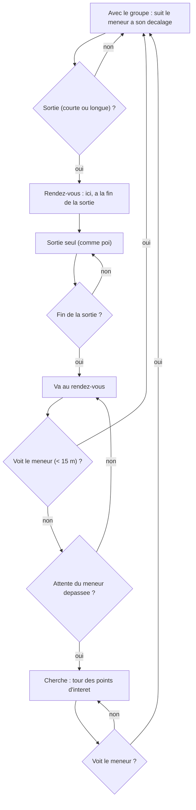

# `group` — groupes d'amis qui se deplacent ensemble

Fichier : `src/festival_ble_sim/mobility/group.py` (`GroupMobility`)
Reglages : `GroupConfig` (`MobilityConfig.group`, `src/festival_ble_sim/config.py`)
Tests : `tests/test_mobility_group.py`
CLI : `--mobility group` (active d'office par `--size`)

## Principe

En festival on se deplace en groupe, et on ecrit surtout a l'ami dont on
vient d'etre separe. Avec `poi`, les groupes d'amis (`SocialConfig`, qui
choisissent aussi les destinataires des messages) etaient tires sans lien
avec les positions : un destinataire etait n'importe ou sur le site.

Modele de groupe a point de reference (RPGM) : chaque groupe d'amis a un
meneur, son plus petit identifiant.

1. **Meneur** : se deplace comme `poi` (memes points d'interet, memes
   pauses).
2. **Membre** : garde un decalage fixe tire dans un disque de
   `radius_m` (5 m) autour du meneur, et le suit a `speed_max_mps`.
3. **Sorties seul** : un membre avec le groupe part seul avec un taux de
   `short_trips_per_hour` (0,5/h, 5 a 30 min : bar, toilettes) ou
   `long_trips_per_hour` (0,2/h, 30 min a 2 h : une autre scene). Pendant
   la sortie, il se deplace comme `poi`.
4. **Rendez-vous** : personne ne peut appeler ni ecrire (le reseau
   cellulaire est sature, et la mobilite ne doit pas dependre du reseau
   simule, sinon chaque algorithme aurait ses propres trajectoires et la
   comparaison a graine egale ne tiendrait plus). Avant de partir, le
   membre et le groupe conviennent donc de se retrouver **ici, a la fin de
   la sortie**. A l'heure dite, le meneur (et tout le groupe avec lui)
   retourne au point de rendez-vous et y attend au plus
   `rendezvous_max_wait_s` (15 min) ; le membre y va aussi.
5. **Recherche** : un membre qui arrive apres la fin de l'attente fait le
   tour des points d'interet (sans pause) jusqu'a voir son groupe, c'est-a-
   dire passer a moins de `visual_range_m` (15 m) du meneur. En revenant
   ou en cherchant, il rejoint le groupe des qu'il le voit.

Les personnes sans amis (`no_friend_fraction`, 20 %) se deplacent comme
`poi`. Les membres demarrent autour de leur meneur
(`simulation.run_simulation` appelle `MobilityModel.join_group` une fois
les groupes tires).

## Diagramme

## Forces

- Les distances source-destination ressemblent a un festival : la plupart
  des amis sont a cote, ceux qui sont separes sont a une autre scene ou au
  bar, ce que la messagerie doit justement couvrir.
- Independant du reseau simule : memes trajectoires pour tous les
  algorithmes a une graine donnee.

## Faiblesses

- Toutes les valeurs de `GroupConfig` sont estimees, pas mesurees.
- Le groupe entier suit le meneur au rendez-vous ; dans la realite le
  groupe peut aussi se scinder.
- Un message envoye a un ami a cote reste un message comme un autre : le
  trafic ne tient pas compte de la proximite (on ecrit autant a l'ami a
  cote qu'a celui qui est parti).

## References

- X. Hong, M. Gerla, G. Pei, C.-C. Chiang, *A Group Mobility Model for Ad
  Hoc Wireless Networks*, ACM MSWiM, 1999. — modele de groupe a point de
  reference (RPGM).
