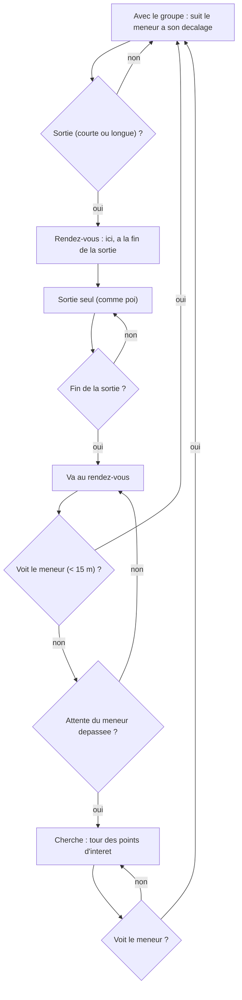

# `group` — groupes d'amis qui se deplacent ensemble

Fichier : `src/festival_ble_sim/mobility/group.py` (`GroupMobility`)
Reglages : `GroupConfig` (`MobilityConfig.group`, `src/festival_ble_sim/config.py`)
Tests : `tests/test_mobility_group.py`
CLI : `--mobility group` (active d'office par `--size`)

## Principe

En festival on se deplace en groupe, et on ecrit surtout a l'ami dont on
vient d'etre separe. Avec `poi`, les groupes d'amis (`SocialConfig`, qui
choisissent aussi les destinataires des messages) etaient tires sans lien
avec les positions : un destinataire etait n'importe ou sur le site.

Modele de groupe a point de reference (RPGM) : chaque groupe d'amis a un
meneur, son plus petit identifiant.

1. **Meneur** : se deplace comme `poi` (memes points d'interet, memes
   pauses).
2. **Membre** : garde un decalage fixe tire dans un disque de
   `radius_m` (5 m) autour du meneur, et le suit a `speed_max_mps`.
3. **Sorties seul** : un membre avec le groupe part seul avec un taux de
   `short_trips_per_hour` (0,5/h, 5 a 30 min : bar, toilettes) ou
   `long_trips_per_hour` (0,2/h, 30 min a 2 h : une autre scene). Pendant
   la sortie, il se deplace comme `poi`.
4. **Rendez-vous** : personne ne peut appeler ni ecrire (le reseau
   cellulaire est sature, et la mobilite ne doit pas dependre du reseau
   simule, sinon chaque algorithme aurait ses propres trajectoires et la
   comparaison a graine egale ne tiendrait plus). Avant de partir, le
   membre et le groupe conviennent donc de se retrouver **ici, a la fin de
   la sortie**. A l'heure dite, le meneur (et tout le groupe avec lui)
   retourne au point de rendez-vous et y attend au plus
   `rendezvous_max_wait_s` (15 min) ; le membre y va aussi.
5. **Recherche** : un membre qui arrive apres la fin de l'attente fait le
   tour des points d'interet (sans pause) jusqu'a voir son groupe, c'est-a-
   dire passer a moins de `visual_range_m` (15 m) du meneur. En revenant
   ou en cherchant, il rejoint le groupe des qu'il le voit.

Les personnes sans amis (`no_friend_fraction`, 20 %) se deplacent comme
`poi`. Les membres demarrent autour de leur meneur
(`simulation.run_simulation` appelle `MobilityModel.join_group` une fois
les groupes tires).

## Effet sur le trafic

On n'ecrit pas a un ami qu'on voit : au moment d'un envoi, les amis a
moins de `TrafficConfig.skip_friends_within_m` (15 m, position reelle)
sont ecartes, le destinataire est tire parmi les autres, et s'il n'en
reste aucun l'envoi est **annule** (pas reporte). Les amis etant les
membres du groupe (`social.assign_friend_groups` fait des groupes
disjoints, et ce sont eux qui se deplacent ensemble) :

- tant que tout le groupe est reuni, personne n'ecrit ;
- les messages naissent d'une **separation** : le membre parti ecrit au
  groupe, ou le groupe ecrit au membre parti (sortie, retour au
  rendez-vous, recherche) ;
- a taux personnel egal (`messages_per_hour_range`), beaucoup moins de
  messages sont crees qu'avec `poi`, ou les amis sont disperses et le
  filtre n'ecarte presque personne. Le taux reel depend donc de
  `GroupConfig` (frequence et duree des sorties).

Les reponses (`--reply-probability`) et relances (`--followup-probability`)
ne repassent pas par ce filtre : elles partent meme si le destinataire est
revenu a moins de 15 m entre-temps (20 a 180 s plus tard, c'est rare).

## Diagramme

## Forces

- Les distances source-destination ressemblent a un festival : la plupart
  des amis sont a cote, ceux qui sont separes sont a une autre scene ou au
  bar, ce que la messagerie doit justement couvrir.
- Independant du reseau simule : memes trajectoires pour tous les
  algorithmes a une graine donnee.

## Faiblesses

- Toutes les valeurs de `GroupConfig` sont estimees, pas mesurees ; comme
  elles fixent le nombre de separations, elles fixent aussi la charge du
  reseau (voir "Effet sur le trafic").
- Le groupe entier suit le meneur au rendez-vous ; dans la realite le
  groupe peut aussi se scinder.
- Tous les amis d'une personne sont dans son groupe : personne n'a d'ami
  venu separement, a l'autre bout du site depuis le debut. Les
  destinataires sont donc toujours un membre parti ou un groupe a un
  rendez-vous connu, jamais un ami qu'on n'a pas vu de la journee.

## References

- X. Hong, M. Gerla, G. Pei, C.-C. Chiang, *A Group Mobility Model for Ad
  Hoc Wireless Networks*, ACM MSWiM, 1999. — modele de groupe a point de
  reference (RPGM).
