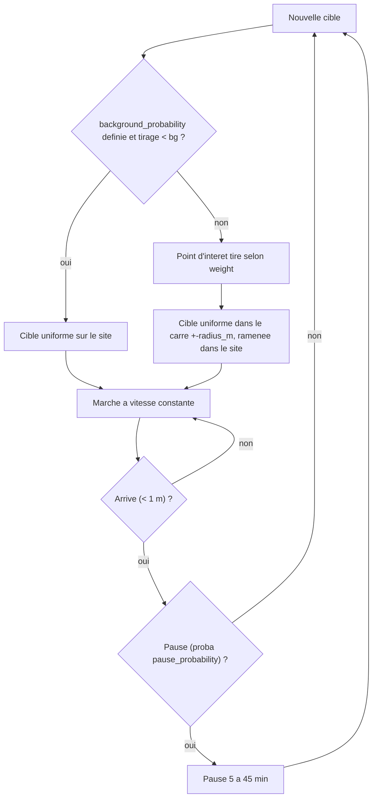

# `poi` — deplacements vers des points d'interet ponderes

Fichier : `src/festival_ble_sim/mobility/poi.py` (`PoiMobility`,
`default_festival_pois`)
Plans de site : `src/festival_ble_sim/presets.py` (`--size`)
Tests : `tests/test_mobility_poi.py`, `tests/test_presets.py`
CLI : `--mobility poi` (active d'office par `--size`)

## Principe

Meme automate marche / pause que `random_waypoint` (voir
`random_waypoint.md`), mais les cibles ne sont plus uniformes : elles sont
tirees autour de points d'interet (`PointOfInterest(x, y, radius_m,
weight)`), pour representer une foule qui converge vers les scenes et les
bars.

1. **Tirage d'une cible** : un point d'interet est choisi avec une
   probabilite proportionnelle a son `weight` (poids negatif compte pour
   0), puis la cible est tiree uniformement dans le **carre** de cote
   `2 x radius_m` centre sur lui (pas un disque), puis ramenee dans le
   site.
2. **Fond uniforme** (`background_probability`, `None` par defaut) : si
   elle est definie, chaque cible et la position de depart sont uniformes
   sur tout le site avec cette probabilite, et autour d'un point
   d'interet sinon.
3. **Depart** : sans `background_probability`, la position de depart est
   uniforme et la foule converge ensuite ; avec, la foule est deja
   repartie au depart.

Il faut au moins un point d'interet de poids positif, et
`background_probability` doit etre dans `[0, 1]`, sinon le constructeur
leve une erreur.

## Diagramme

## Plans de site

**Sans `--size`** (site 700 x 500 m, 4 000 festivaliers) :
`default_festival_pois`, `background_probability = None`.

| Point d'interet | Centre (fraction du site) | Demi-cote | Poids |
|---|---|---|---|
| grande scene | (0.25, 0.75) | 0.15 x min(l, h) = 75 m | 4 |
| bars / restauration | (0.55, 0.35) | 0.12 x min = 60 m | 3 |
| deuxieme scene | (0.80, 0.70) | 0.10 x min = 50 m | 2 |
| entree / toilettes | (0.50, 0.05) | 0.08 x min = 40 m | 1 |

Les carres couvrent environ 15 % du site. Le carre de l'entree deborde
du bord (y de -15 a 65 m) : environ 19 % de ses cibles, soit 1,8 % de
toutes les cibles, sont ecrasees sur le bord y = 0.

**Avec `--size`** (`small`, `medium`, `large`, `extra-large`, ~3 m2 par
personne) : `crowd_mobility_config`.
- Memes positions et poids, mais les cotes des carres sont
  proportionnels a la racine du poids, pour que chaque point d'interet ait
  la meme densite, et ils couvrent ensemble 15 % du site
  (`DENSE_AREA_FRACTION`). Les centres sont rapproches du bord si besoin,
  pour qu'aucun carre ne soit tronque.
- `background_probability = (1 - 0.70) / (1 - 0.15)`, environ 0,35 :
  70 % des cibles tombent dans la zone dense (`DENSE_POPULATION_SHARE`),
  en comptant les cibles uniformes qui y tombent par hasard.
- En `small` (130 x 93 m), les demi-cotes vont de 6,7 m (entree) a
  13,5 m (grande scene), soit moins qu'une portee radio de 30 m.
- La part mesuree dans la zone dense est un peu sous 70 % (environ 67 %
  en `small`, 63 % en `large`) : les gens en marche sont hors zone dense.

## Parametres (`MobilityConfig`)

Ceux de `random_waypoint` (vitesse 0,3 a 1,2 m/s, pause 70 % de 5 a
45 min), plus :

| Parametre | Defaut | Role |
|---|---|---|
| `points_of_interest` | `()` (le CLI fournit le plan) | points d'interet ponderes |
| `background_probability` | `None` | part de cibles uniformes (et depart reparti si defini) |
| `schedule` | `None` | programme du festival (`ScheduleConfig`), voir ci-dessous |

### Programme du festival (`--schedule`, option)

Avec `MobilityConfig.schedule = ScheduleConfig()` (`--schedule` dans
`main.py` et `compare_algorithms.py`), des concerts de `set_s` (1 h)
alternent entre les scenes `stages` (indices dans `points_of_interest` :
`(0, 1)`, la grande et la deuxieme scene des deux plans), des le debut du
run, chauffe comprise. Pendant un concert, le poids de sa scene est
multiplie par `boost` (3), et au debut de chaque concert chaque personne
en pause coupe sa pause avec la probabilite `rush_probability` (0,3) pour
choisir une nouvelle cible : la foule bouge par vagues. Toutes ces valeurs
sont estimees. L'heure vient de la simulation (`MobilityModel.set_clock`,
appele par `run_simulation` avec `env.now`), pour que les sorties de
`group` et les retardataires suivent le meme programme. Sans effet en
`random_waypoint`, qui n'a pas de scenes.

`MOBILITY_FACTORIES` (`main.py`) n'a pas d'option CLI propre : pour un
autre plan, construire un `MobilityConfig(points_of_interest=(...))` et le
passer a `SimulationConfig(mobility=...)` avec
`mobility_factory=lambda rng: PoiMobility(config.mobility, rng=rng)`.

## Ordres de grandeur

Plan par defaut, 1 000 noeuds, mesure directe du modele (sans radio) :
- environ 85 % des noeuds sont dans un carre de point d'interet en regime
  etabli (77 % a 10 min, la foule part d'une position uniforme), contre
  15 a 18 % en `random_waypoint` ;
- 73 a 76 % des noeuds en pause a tout instant apres 30 min.

## Forces

- Foule dense et contacts repetes autour des scenes et des bars : plus
  realiste pour un festival. Les algos a historique de rencontres en
  profitent : `prophet` livre 45,8 % en `poi` contre 30,3 % en
  `random_waypoint` (500 festivaliers, 30 min, graine 42).
- `--size` donne des scenarios a densite fixee (~3 m2 par personne,
  70 % de la foule sur 15 % du site), comparables d'une taille a l'autre.
- Plan reglable sans toucher au code (poids, tailles, fond uniforme).

## Faiblesses

- Choix de la cible sans memoire. Sans `--schedule`, pas d'horaire du
  tout ; avec, un programme simple (deux scenes en alternance, sets de
  meme duree), sans heure de pointe au bar ni depart groupe en fin de
  set.
- Deplacements independants : des amis ne se deplacent pas ensemble,
  ce qui penalise `bubble_f` ; c'est le role de `group`.
- Pas d'evitement ni de ralentissement dans la foule dense : la vitesse
  ne depend pas de la densite, et les noeuds peuvent se superposer.
- Zones carrees et, sans `--size`, carre de l'entree tronque par le bord
  du site.
- Sans `--size`, le depart est uniforme : les premieres minutes ne
  representent pas la foule repartie.
