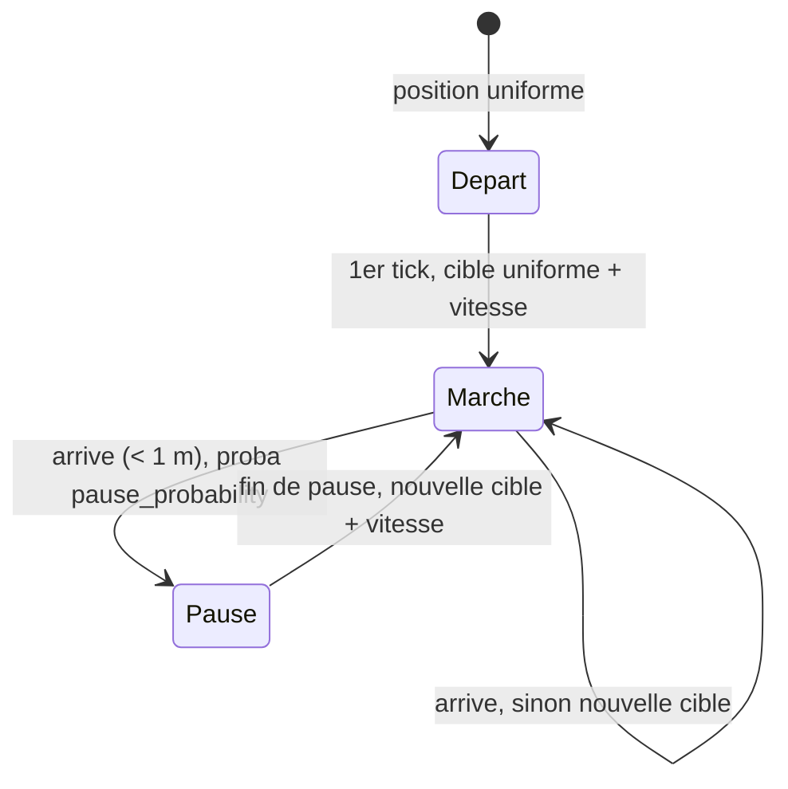

# `random_waypoint` — Random Waypoint avec pauses

Fichier : `src/festival_ble_sim/mobility/random_waypoint.py`
Tests : `tests/test_mobility.py`
CLI : `--mobility random_waypoint` (defaut de `main.py` et des scripts,
sauf avec `--size`, qui passe a `poi`)

## Principe

Modele de reference de la litterature DTN. Chaque festivalier :

1. demarre a une position uniforme sur le site ;
2. au premier tick, tire une cible uniforme sur tout le site et une vitesse
   uniforme dans `[speed_min_mps, speed_max_mps]`, gardee pour toute
   l'etape ; il ne bouge pas ce tick-la ;
3. marche en ligne droite vers la cible (`move_towards`, sans depasser la
   cible) ;
4. arrive a moins de 1 m : avec la probabilite `pause_probability`, il
   s'arrete une duree uniforme dans `pause_duration_range_s` ; sinon il
   tire tout de suite une nouvelle cible et repart dans le meme tick ;
5. a la fin d'une pause, il tire une nouvelle cible (sans bouger ce
   tick-la), et ainsi de suite.

Le moteur appelle `step` toutes les `tick_interval_s` (1 s) pour chaque
noeud actif ; un noeud inactif (churn, batterie vide) reste fige. Chaque
noeud a sa propre instance et son propre RNG, derive de `random_seed`.

## Diagramme

## Parametres (`MobilityConfig`)

| Parametre | Defaut | Role |
|---|---|---|
| `speed_min_mps`, `speed_max_mps` | 0.3, 1.2 | vitesse de marche en foule, tiree par etape |
| `pause_probability` | 0.7 | chance de s'arreter a chaque cible |
| `pause_duration_range_s` | (300, 2700) | pause de 5 a 45 min (un concert, une file) |
| `tick_interval_s` | 1.0 | pas de temps du deplacement |

`points_of_interest` et `background_probability` sont ignores.

## Ordres de grandeur

Site par defaut 700 x 500 m, 1 000 noeuds, mesure directe du modele (sans
radio) :
- etape moyenne de 315 m, soit environ 7 min a 0,75 m/s ;
- environ 70 % des noeuds sont en pause a tout instant apres 30 min
  (57 % a 10 min : au depart, tout le monde marche) ;
- le quart central du site contient environ 30 % des noeuds en regime
  etabli (36 % a 10 min) : leger biais vers le centre, connu pour ce
  modele, car les trajets en ligne droite le traversent souvent.

## Forces

- Simple, sans parametre de site : sert de reference pour comparer les
  algos de routage.
- Rencontres peu repetitives : un bon test pour les algos qui ne doivent
  pas compter sur des habitudes (spray, gossip).
- Pas de biais de `min_speed = 0` (vitesse minimale de 0,3 m/s), donc pas
  de noeuds quasi immobiles pour toujours.

## Faiblesses

- Aucune structure de festival : pas de scenes, de bars ni de foule
  dense ; densite presque uniforme (hors leger biais central).
- Mouvements independants : des amis ne se deplacent pas ensemble, ce qui
  penalise les algos sociaux (`bubble_f`).
- Les algos fondes sur l'historique de rencontres (`prophet`, `tide`) y
  trouvent peu d'information.
- Pas de demi-tour, d'evitement ni de ralentissement selon la densite :
  vitesse constante pendant toute l'etape.
- Tout le monde marche au debut : les premieres minutes ne sont pas en
  regime etabli.
